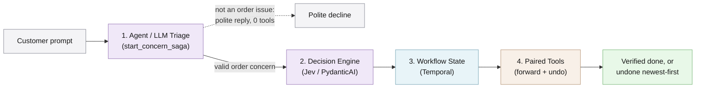

# Agentic Saga

Turn a customer's messy order concern into a safe multi-step fix on Temporal, with automatic undo if a step fails.

**Try it:** `git clone https://github.com/gainratio/agentic-saga && cd agentic-saga && uv run poe demo` opens a live run in your browser. No API key.

Suppose a customer writes: *"I paid $79 four days ago for `order_8841` and still haven't received
it — please rush a replacement or refund me."* Resolving that touches inventory, billing, courier
booking, and depot tracking. If the depot check reveals the original parcel was just scanned onto a
delivery truck after you booked an express courier and issued a $15 courtesy credit, every finished
step has to be undone newest-first so you never ship twice or leave money out of sync. A language
model is great at reading the customer's message, and terrible at inventing rollback logic or
guessing whether a lost reply succeeded.

Agentic Saga combines four layers so each part only does what it is good at:

1. **Agent + LLM intake (`start_concern_saga`)** reads the customer's free-form prompt — and if the
   prompt is **not** an order processing issue, politely replies so with zero workflows started and
   zero tool calls.
2. **Constrained step decision engine (`Jev` / `PydanticAI`)** sees only the steps allowed right now
   and proposes one forward step at a time.
3. **Durable workflow state ([Temporal](https://temporal.io))** checks rules and budgets, reconciles
   lost replies before retrying, checks proof, runs automatic newest-first compensating transactions
   when proof fails, and pauses for a person if an undo reply is uncertain.
4. **Deterministic paired tools (`ToolRegistry`)** validate strict Pydantic inputs and pair every
   forward change with its exact undo tool.

**Technical docs:** [Architecture](docs/ARCHITECTURE.md) · [Use it in your app](docs/integration.md) · [Getting started for developers](docs/GETTING_STARTED.md) · [Agent adapters](docs/agent-adapter.md) · [Safety rules](docs/temporal-safety-contract.md) · [Operations](docs/operations.md)


**[Watch the 1080p walkthrough](https://open-source.gainratio.com/agentic-saga/)** · **[30-second Safe Local Agents overview](https://open-source.gainratio.com/safe-local-agents/)**

## Try it

You need [uv](https://docs.astral.sh/uv/), git, and an internet connection for the first run. uv
installs a matching Python and the dependencies if you don't have them. Nothing else to install, and
no account or API key.

```bash
git clone https://github.com/gainratio/agentic-saga.git
cd agentic-saga
uv run poe demo
```

The command checks the customer prompt first, starts a throwaway Temporal server on your machine
(the first run downloads Python, dependencies, and Temporal in under a minute), runs the
order-concern saga, and opens the Flight Recorder page above. Each step takes about a second and a
half so you can watch it happen:

1. Intake accepts the customer's paid-not-delivered message for `order_8841`.
2. The step chooser holds a replacement item, applies a $15 courtesy credit, and books an express
   courier.
3. The depot check (`verify_original_stopped`) finds the original parcel was just scanned onto a
   delivery truck.
4. Temporal undoes every finished step newest-first: cancel the express courier, reverse the $15
   credit, and release the replacement item.

Your terminal shows the live run (port numbers vary; Temporal also prints a harmless `WARN ...
Cluster Id` line):

```text
Agentic Saga live demo: already-in-transit (original parcel is scanned onto the truck after courier booking, so earlier steps undo).
Customer prompt: "I paid $79 four days ago for order_8841 and still haven't received it — please rush a replacement or refund me."
Layers: 1) Intake accepted order concern -> 2) Constrained step engine -> 3) Temporal workflow state -> 4) Paired deterministic tools.
Temporal: starting a throwaway local server (the first run downloads it once)…
  …
  09 invariant_evaluated verify_original_stopped -> running
  10 compensation_started -> compensating
  11 compensation_outcome_recorded cancel_express_courier -> compensating
  12 compensation_outcome_recorded reverse_shipping_credit -> compensating
  13 compensation_outcome_recorded release_replacement -> compensating
  14 compensation_completed -> compensating
  15 terminal_assigned -> compensated_verified
Recorder: http://127.0.0.1:51946  (this page updates every second)
Live run finished: compensated_verified. Press Ctrl+C to stop the page.
```

Now try an unrelated prompt — intake politely declines before starting Temporal or calling any tool:

```bash
uv run poe demo not-an-order
# or pass any custom prompt:
uv run poe demo --prompt "What is the weather in Seattle this weekend?"
```

```text
Agentic Saga live demo: customer concern intake.
Customer prompt: "What is the weather in Seattle this weekend?"
Agent reply: "That doesn't look like an order processing issue. I can help when an order you paid for hasn't arrived or needs a replacement or refund — no order changes were started."
Outcome: polite_decline (not an order processing issue; 0 workflows started, 0 tools).
```

Three other runs show the remaining saga outcomes (and `uv run poe demo-checkout` runs the classic
checkout demo):

```bash
uv run poe demo happy-path            # original parcel stopped at depot; express replacement ships
uv run poe demo lost-response         # billing reply is lost; reconciled instead of crediting twice
uv run poe demo compensation-failure  # credit reversal reply is lost; pauses for a support lead
```

Add `--step-delay 0` to run at full speed, or `--temporal-address localhost:7233` to use a
Temporal server you already started with `temporal server start-dev`.

## Use it in your own code

Install it from GitHub (it is not on PyPI yet):

```bash
uv add "agentic-saga @ git+https://github.com/gainratio/agentic-saga"
```

The smallest complete program is [`examples/quickstart/trip.py`](examples/quickstart/trip.py) (for
the full 4-layer customer intake + saga example, see
[`examples/order_concern/`](examples/order_concern/README.md)). `trip.py` books a flight and a
hotel, fails the final check, and cancels both. First, register each step that changes something,
and name the step that undoes it:

```python
def build_registry(forward: list[str], undo: list[str]) -> ToolRegistry:
    return ToolRegistry(
        (
            booking("book_flight", "cancel_flight", forward),
            booking("book_hotel", "cancel_hotel", forward),
            booking("cancel_flight", None, undo),
            booking("cancel_hotel", None, undo),
            ReadToolDefinition("confirm_trip", Trip, TripCheck, FakeTripCheck(forward)),
        )
    )
```

`booking(...)` wraps your API call in an `EffectToolDefinition`; `confirm_trip` is a read-only
check. Then tell the workflow the order of the steps and which check proves the job is done:

```python
WORKFLOW_TOOLS = (
    WorkflowTool(name="book_flight", kind="effect", compensation_tool="cancel_flight"),
    WorkflowTool(
        name="book_hotel",
        kind="effect",
        compensation_tool="cancel_hotel",
        prerequisites=("book_flight",),
    ),
    WorkflowTool(
        name="confirm_trip", kind="read", proof_for_success=True, prerequisites=("book_hotel",)
    ),
)
```

Finally, start a worker and the saga, and wait for the result (or call `start_concern_saga(...)` to
place LLM intake triage in front of `start_saga(...)`). To use a live model for step decisions,
build a driver from the [agent adapter guide](docs/agent-adapter.md) and pass it in place of
`ScriptedAgent()`:

```python
    activities = TemporalActivities(ScriptedAgent(), build_registry(forward, undo), BUDGET)
    async with (
        await WorkflowEnvironment.start_time_skipping(
            data_converter=pydantic_data_converter
        ) as env,
        build_worker(
            env.client,
            task_queue=TASK_QUEUE,
            activities=activities,
            human_resolution_activity=no_human_operator,
        ),
    ):
        handle = await start_saga(env.client, trip_saga(), task_queue=TASK_QUEUE)
        state = await handle.result()
```

Run it with `uv run python -m examples.quickstart.trip` from this repository, or copy the file
into your own project and run `python trip.py`:

```text
Forward steps: book_flight -> book_hotel -> confirm_trip
Undo steps:    cancel_hotel -> cancel_flight
Outcome:       compensated_verified
```

The code above is cut straight from [`examples/quickstart/trip.py`](examples/quickstart/trip.py),
and a test verifies it cannot drift. The [integration guide](docs/integration.md) explains real
Temporal / Temporal Cloud setup and durable service adapters.

---

## Under the hood (for developers)

- [`src/agentic_saga/`](src/agentic_saga/): `triage.py` concern intake (`start_concern_saga`, `ClassifiedConcernTriage`, `build_pydantic_ai_concern_classifier`), Temporal Workflow & Activities, step registry, `saga.yaml` manifest parser, and decision adapters (`OpenRouterDecisions`, `Jev`, `PydanticAIDriver`).
- [`examples/order_concern/`](examples/order_concern/README.md): the 4-layer paid-not-delivered customer concern demo served by `uv run poe demo`.
- [`examples/ecommerce/`](examples/ecommerce/README.md) & [`examples/quickstart/`](examples/quickstart/trip.py): classic checkout demo (`uv run poe demo-checkout`) and minimal `trip.py`.
- [`web/flight-recorder/`](docs/flight-recorder.md): React trace viewer served by `uv run poe demo`.
- [`.env.example`](.env.example): optional model keys (`OPENROUTER_API_KEY`, `TYPESAFE_API_KEY`) and Temporal connection settings (`cp .env.example .env`).

## How it works



Your code registers each step as a typed Python function and pairs every forward change with the
step that undoes it (`reserve_replacement` with `release_replacement`, `issue_shipping_credit` with
`reverse_shipping_credit`, `book_express_courier` with `cancel_express_courier`). Once intake
accepts a relevant concern, the decision engine sees only the steps allowed right now and proposes
one. The Temporal Workflow checks that choice against rules and budgets, runs the tool, reconciles
any lost reply before retrying, requires a fresh read on `proof_for_success=True`, and undoes
finished steps newest-first if proof fails.

### Who decides the next step

The default decision engine for real step selection is Jev (a compact structured-decision model from
TypeSafe AI). Your app lists the currently eligible steps, and Jev picks one and reports confidence
without writing free-form undo logic. Jev runs inside the `agentic_saga.decide` Temporal Activity so
replays read recorded history instead of calling the model again. It needs one key,
`OPENROUTER_API_KEY`:

```python
from agentic_saga.agents import OpenRouterDecisionsSettings, build_openrouter_decisions_driver

# context: your SagaContext; candidates: async function returning the allowed ProposalCandidates
driver = build_openrouter_decisions_driver(
    context, candidates, OpenRouterDecisionsSettings.from_environment()
)
```

Alternatives are Jev called directly (`build_jev_driver` with `TYPESAFE_API_KEY`), any tool-calling
model through [Pydantic AI](https://ai.pydantic.dev) and OpenRouter, or a local deterministic driver
like the one in the zero-key demo. All four are covered in the
[agent adapter guide](docs/agent-adapter.md).

### The browser page

The Flight Recorder is a small React app bundled with the library. `uv run poe demo` updates it live
every second with a plain-English explanation on top and **Technical details for developers** folded
underneath. `uv run agentic-saga demo --open` serves pre-recorded runs offline without Temporal.

## What it does not do

- **It is not released on PyPI yet.** Version 0.1.0 is installed from GitHub.
- **It cannot make an outside service safe to retry.** Your payment, credit, or stock service must
  accept a stable request ID so a repeated call is recognized. The example services are simulations.
- **It needs a Temporal server.** The demo and examples start a throwaway one for you. Real use
  needs your own (`temporal server start-dev` locally) or Temporal Cloud.
- **It does not judge the AI model.** Offline tests never call a paid model.
- **Anything you put in a step's inputs is stored in Temporal.** Use Temporal's payload encryption
  for private data. With a live model enabled, public context and eligible steps are sent to your
  configured model service.
- **Recorded runs are hash-checked, not signed.** Someone who can edit a trace file can rewrite it.
- Python 3.12 or 3.13 on Linux or macOS only.

## When to use something else

| If you need | Use |
| --- | --- |
| Every change lives in one database | A database transaction |
| A fixed form with no free-form user request and a static sequence of steps | Temporal on its own |
| An agent that only reads or drafts, and nothing it does needs rollback | An agent framework calling tools directly |
| A few routes you can write out by hand | Plain `if/else` code |
| Free-form user concerns turned into multi-step changes with deterministic undo and proof | Agentic Saga |

## Develop

```bash
uv run poe gate
```

This runs the Python checks CI runs: formatting, lint, strict typing, complexity, offline tests,
Temporal tests, and at least 90% branch coverage on the core. The browser app in
`web/flight-recorder/` has its own check. [Getting started for developers](docs/GETTING_STARTED.md)
covers prerequisites, timings, a map of the code, and your first change. Then read
[CONTRIBUTING.md](CONTRIBUTING.md).

## More detail

- [Order-concern example](examples/order_concern/README.md): the 4-layer customer concern intake,
  step chooser, Temporal state, and paired tools demo.
- [Use it in your app](docs/integration.md): the minimal example explained, real Temporal and
  Temporal Cloud, real service adapters, and picking an agent.
- [Getting started for developers](docs/GETTING_STARTED.md): from a fresh clone to a green local
  build and your first change.
- [Architecture](docs/ARCHITECTURE.md): the flow, the building blocks, the source map, security,
  and what the tests prove.
- [Explore the interactive architecture map](docs/architecture/index.html).
- [Temporal safety contract](docs/temporal-safety-contract.md): the exact rules the Workflow
  enforces.
- [Operations](docs/operations.md): running Workers, retries, human pauses, and known limits.
- [Agent adapters](docs/agent-adapter.md): Jev through OpenRouter (the default), Jev direct,
  Pydantic AI, and the scripted driver.
- [Context manifest](docs/context-manifest.md): describing a job to the agent in `saga.yaml`.
- [Flight Recorder](docs/flight-recorder.md): the browser page, live and recorded.
- [ADR 0001](docs/adr/0001-temporal-runtime.md): why Temporal is the only durability engine.
- [Quality review, 2026-09-19](docs/NORTHSTAR-REVIEW.md): an internal review and its findings.
- [Ecommerce example](examples/ecommerce/README.md): the classic checkout with all four outcomes.
- [PROVENANCE.md](PROVENANCE.md): how a release candidate is built and checked.
- [SECURITY.md](SECURITY.md), [CHANGELOG.md](CHANGELOG.md), and
  [THIRD_PARTY_NOTICES.md](THIRD_PARTY_NOTICES.md).

## License

MIT — see [LICENSE](LICENSE). To cite this project, use [CITATION.cff](CITATION.cff).
