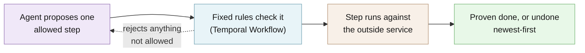

# Agentic Saga

A Python library that lets an AI agent run multi-step jobs like a checkout, and undoes finished steps if one fails.

**Try it:** `git clone https://github.com/gainratio/agentic-saga && cd agentic-saga && uv run poe demo` opens a live run in your browser. No API key.

A checkout touches several outside services: reserve the stock, charge the card, book the
delivery. If the delivery company says no after the card was charged, someone has to refund the
card and release the stock, in that order, exactly once. Doing that by hand in code is fiddly.
Letting an AI agent do it is worse: you do not want a language model deciding when to refund or
whether a lost response means "paid" or "not paid".

Agentic Saga splits the job. The agent only picks the next step from a short list of steps that
are allowed right now. Ordinary Python rules, run by [Temporal](https://temporal.io) (an
open-source service that records every step, so a crash does not lose work), check that choice,
run the step, and undo the finished steps newest-first if the job cannot be proven done. If even
the undo cannot be proven, it stops and waits for a person.

**Technical docs:** [Architecture](docs/ARCHITECTURE.md) · [Use it in your app](docs/integration.md) · [Getting started for developers](docs/GETTING_STARTED.md) · [Agent adapters](docs/agent-adapter.md) · [Safety rules](docs/temporal-safety-contract.md) · [Operations](docs/operations.md)


## Try it

You need [uv](https://docs.astral.sh/uv/), git, and an internet connection for the first run. uv
installs a matching Python and the dependencies if you don't have them. Nothing else to install, and no
account or API key.

```bash
git clone https://github.com/gainratio/agentic-saga.git
cd agentic-saga
uv run poe demo
```

The command starts a throwaway Temporal server on your machine (the first run downloads Python,
the dependencies, and Temporal: under a minute on a fast connection), runs one checkout on it, and
opens the page above. If no browser can open, it prints the page's address instead. The page
explains itself in plain words, so you can show it to someone who doesn't write code. Each step
takes about a second and a half so you can follow it:

1. The agent reserves the item, charges the card, and books the delivery.
2. The final check fails: the delivery company turned the order down.
3. The earlier steps are undone, newest first: cancel the delivery, refund the card, release the
   item. A caption says what is happening and why.
4. The page ends with a plain summary: nothing was left half-done.

The agent in this demo is a fixed script and the shop is simulated, so no money moves and no AI
model is called. The page says so. Developers can open **Technical details for developers** for
the full record of every step. Your terminal shows the same run (a real run, shortened; port
numbers change each time; Temporal also prints a few lines of its own, including a harmless
`WARN ... Cluster Id` line):

```text
Agentic Saga live demo: business-failure (delivery fails after payment, so earlier steps are undone).
Mode: scripted agent, simulated shop services, no API key, no model calls.
Temporal: starting a throwaway local server (the first run downloads it once)…
Recorder: http://127.0.0.1:62969  (this page updates every second)
  …
  09 invariant_evaluated verify_order -> running
  10 compensation_started -> compensating
  11 compensation_outcome_recorded cancel_fulfillment -> compensating
  …
  15 terminal_assigned -> compensated_verified
Live run finished: compensated_verified. Press Ctrl+C to stop the page.
```

The page stays open after the run. Press Ctrl+C to stop. Three other runs show the other cases:

```bash
uv run poe demo happy-path            # every step works
uv run poe demo lost-response         # the card company's reply is lost; it asks, not charges again
uv run poe demo compensation-failure  # the refund can't be confirmed, so a person must sign off
```

In `compensation-failure` the demo plays the person and signs off for them, so the undo can finish.

Add `--step-delay 0` to run at full speed, or `--temporal-address localhost:7233` to use a
Temporal server you already started with `temporal server start-dev`. You can see that server's
own view of the run in its web UI at `localhost:8233`.

## Use it in your own code

Install it from GitHub (it is not on PyPI yet):

```bash
uv add "agentic-saga @ git+https://github.com/gainratio/agentic-saga"
```

The smallest complete program is [`examples/quickstart/trip.py`](examples/quickstart/trip.py). It
books a flight and a hotel, then a final check fails, and the saga cancels both. Here are its key
parts. First, register each step that changes something, and name the step that undoes it:

```python
def build_registry(forward: list[str], undo: list[str]) -> ToolRegistry:
    return ToolRegistry(
        (
            booking("book_flight", "cancel_flight", forward),
            booking("book_hotel", "cancel_hotel", forward),
            booking("cancel_flight", None, undo),
            booking("cancel_hotel", None, undo),
            ReadToolDefinition("confirm_trip", Trip, TripCheck, FakeTripCheck(forward)),
        )
    )
```

`booking(...)` wraps your API call in an `EffectToolDefinition`; `confirm_trip` is a read-only
check. Then tell the workflow the order of the steps and which check proves the job is done:

```python
WORKFLOW_TOOLS = (
    WorkflowTool(name="book_flight", kind="effect", compensation_tool="cancel_flight"),
    WorkflowTool(
        name="book_hotel",
        kind="effect",
        compensation_tool="cancel_hotel",
        prerequisites=("book_flight",),
    ),
    WorkflowTool(
        name="confirm_trip", kind="read", proof_for_success=True, prerequisites=("book_hotel",)
    ),
)
```

Finally, start a worker and the saga, and wait for the result. Here the agent is a script. To use
a model instead, build a driver from the [agent adapter guide](docs/agent-adapter.md) and pass it in
place of `ScriptedAgent()`; it also needs a function that lists the allowed steps:

```python
    activities = TemporalActivities(ScriptedAgent(), build_registry(forward, undo), BUDGET)
    async with (
        await WorkflowEnvironment.start_time_skipping(
            data_converter=pydantic_data_converter
        ) as env,
        build_worker(
            env.client,
            task_queue=TASK_QUEUE,
            activities=activities,
            human_resolution_activity=no_human_operator,
        ),
    ):
        handle = await start_saga(env.client, trip_saga(), task_queue=TASK_QUEUE)
        state = await handle.result()
```

Run it with `uv run python -m examples.quickstart.trip` from this repository, or copy the file
into your own project and run `python trip.py`:

```text
Forward steps: book_flight -> book_hotel -> confirm_trip
Undo steps:    cancel_hotel -> cancel_flight
Outcome:       compensated_verified
```

Temporal's test server may print one `WARN ... Temporal Server 1.16.0 or newer is required` line
first. It is harmless.

The code above is cut straight from that file, and a test runs the file, so this section cannot
drift from what works. The [integration guide](docs/integration.md) explains each part, the rules
that are easy to miss, how to connect a real Temporal server or Temporal Cloud, and what a real
service adapter must do (a stable request ID, and a way to look up a lost reply).

## How it works



Your code registers each step as a typed Python function, and pairs every step that changes
something with the step that undoes it (charge with refund, reserve with release). On each turn the
agent sees the goal, the current facts, and only the steps allowed right now, and proposes one.
A Temporal Workflow checks the proposal against those rules and limits, runs the step, and records
the result. If a reply is lost, it asks the provider what happened before doing anything else. A
step marked `proof_for_success=True` must be followed by a fresh authoritative read before the job
can finish; otherwise every finished step is undone in reverse order, and a person is asked only
when the undo itself cannot be proven. Proof is explicit: an effect with no proof read is treated
as done when its own call succeeds.

### Who decides the next step

The default decision engine for real use is Jev (a compact structured-decision model from TypeSafe AI), a model that only picks the next step. Your app
lists the steps allowed right now, and Jev chooses one and says how sure it is. It never writes
arguments and never decides how to undo; the workflow does that. Jev runs inside the
`agentic_saga.decide` Temporal Activity, so its answer is recorded and a replay reads the recorded
answer instead of asking again. It needs one key, `OPENROUTER_API_KEY`:

```python
from agentic_saga.agents import OpenRouterDecisionsSettings, build_openrouter_decisions_driver

# context: your SagaContext; candidates: async function returning the allowed ProposalCandidates
driver = build_openrouter_decisions_driver(
    context, candidates, OpenRouterDecisionsSettings.from_environment()
)
```

The alternatives are Jev called directly through its maker TypeSafe's own API (`build_jev_driver`
with `TYPESAFE_API_KEY`), any model that supports tool calling through
[Pydantic AI](https://ai.pydantic.dev) and OpenRouter, or a scripted driver like the one in the
demo. All four are in the [agent adapter guide](docs/agent-adapter.md), with a full runnable
example.

### The browser page

The browser page is the Flight Recorder, a small React app bundled with the library. It reads the
run's record and draws it; it never runs anything itself. `uv run poe demo` serves it while the run
is still going, with a plain-language view on top and the full developer view folded underneath. `uv run agentic-saga demo --open` serves four recorded runs without Temporal.

## What it does not do

- **It is not released.** Version 0.1.0 is not on PyPI and has no tagged release. Install it from
  GitHub.
- **It cannot make an outside service safe to retry.** Your payment or stock service must accept a
  stable request ID so a repeated call is recognized. The example services are simulations.
- **It needs a Temporal server.** The demo and examples start a throwaway one for you. Real use
  needs your own (`temporal server start-dev` locally) or Temporal Cloud.
- **It does not judge the AI model.** Tests never call a paid model. How well a live model picks
  steps is not tested here.
- **Anything you put in a step's inputs is stored in Temporal.** Use Temporal's payload encryption
  for private data. With an AI agent on, the goal, the current facts, and the allowed steps are sent
  to OpenRouter with your key.
- **Recorded runs are hash-checked, not signed.** Someone who can edit a trace file can rewrite it.
- Python 3.12 or 3.13 on Linux or macOS only.

## When to use something else

| If you need | Use |
| --- | --- |
| Every change lives in one database | A database transaction |
| A fixed sequence of steps that rarely changes | Temporal on its own |
| An agent that only reads or drafts, and nothing it does is hard to undo | An agent framework calling tools directly |
| A few routes you can write out by hand | Plain `if/else` code |
| An agent picking steps that change real things, with undo and proof built in | Agentic Saga |

## Develop

```bash
uv run poe gate
```

This runs the Python checks CI runs: formatting, lint, strict typing, complexity, offline tests,
Temporal tests, and at least 90% branch coverage on the core. The browser app in
`web/flight-recorder/` has its own check. [Getting started for developers](docs/GETTING_STARTED.md)
covers prerequisites, timings, a map of the code, and your first change. Then read
[CONTRIBUTING.md](CONTRIBUTING.md).

## More detail

- [Use it in your app](docs/integration.md): the minimal example explained, real Temporal and
  Temporal Cloud, real service adapters, and picking an agent.
- [Getting started for developers](docs/GETTING_STARTED.md): from a fresh clone to a green local
  build and your first change.
- [Architecture](docs/ARCHITECTURE.md): the flow, the building blocks, the source map, security,
  and what the tests prove.
- [Explore the interactive architecture map](docs/architecture/index.html).
- [Temporal safety contract](docs/temporal-safety-contract.md): the exact rules the Workflow
  enforces.
- [Operations](docs/operations.md): running Workers, retries, human pauses, and known limits.
- [Agent adapters](docs/agent-adapter.md): Jev through OpenRouter (the default), Jev direct,
  Pydantic AI, and the scripted driver.
- [Context manifest](docs/context-manifest.md): describing a job to the agent in `saga.yaml`.
- [Flight Recorder](docs/flight-recorder.md): the browser page, live and recorded.
- [ADR 0001](docs/adr/0001-temporal-runtime.md): why Temporal is the only durability engine.
- [Quality review, 2026-09-19](docs/NORTHSTAR-REVIEW.md): an internal review and its findings.
- [Ecommerce example](examples/ecommerce/README.md): the full checkout with all four outcomes.
- [PROVENANCE.md](PROVENANCE.md): how a release candidate is built and checked.
- [SECURITY.md](SECURITY.md), [CHANGELOG.md](CHANGELOG.md), and
  [THIRD_PARTY_NOTICES.md](THIRD_PARTY_NOTICES.md).

## License

MIT — see [LICENSE](LICENSE). To cite this project, use [CITATION.cff](CITATION.cff).
